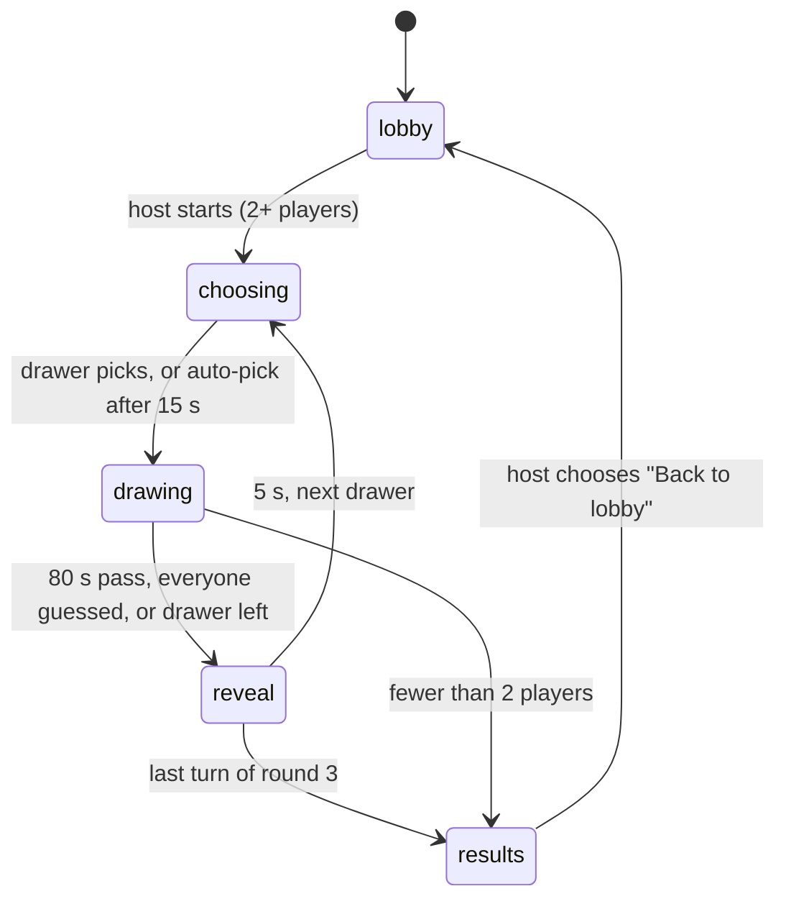

## Context

R1 needs private rooms joined by link, a lobby, turns through three rounds, timers, and the connection rules in design doc §5 (2–8 players, a 60 s reconnect window, late joiners, the drawer or host leaving). ADR-002 keeps everything in one Node process on the owner's PC, with rooms in memory.

## Options considered

| Option | Pros | Cons |
|---|---|---|
| Server-authoritative state machine; full state snapshot per change (chosen) | One source of truth; cheating-resistant (guessers never receive the word); snapshots are tiny with at most 8 players; easy to test | Every change resends the room view |
| Server sends diffs | Fewer bytes | More code, and diff bugs can desync clients; not worth it at 8 players |
| Clients run the game; the server relays | Less server code | The word would reach every client; timers and scores could disagree |

## Decision

**Rooms.** Rooms are kept in a `Map` keyed by a 6-letter code from an alphabet without I, L or O, so a code has about 148 million possible values. The invite link is `http://<LAN address>:3000/r/<code>`. A room is deleted 5 minutes after its last player leaves.

**Players.** Each player has an id, name (1–16 characters), color, score, `joinedAt` and `connected`. On first join the server issues a random 128-bit session token. The client stores it in `localStorage` per room and sends it back on reconnect.

**Phases** (timers run on the server and use an injected clock):

**Turn order.** Players draw in join order, and each player draws once per round, for 3 rounds. Late joiners can guess straight away and join the drawing order from the next round.

**State to clients.** On every change the server sends `room:state`, a view built for each player:
- The drawer sees the word.
- Players who have guessed it see the word.
- Everyone else sees the mask, for example `_ _ _   _ _ _`.

Deadlines are sent as server timestamps (`endsAt`). Clients correct for clock offset with `time:sync`.

**Chat.** A message that matches the word (ADR-006):
- is never broadcast;
- marks the guesser correct;
- adds a "<name> guessed the word!" system line.

After guessing, a player's messages go only to the drawer and the other players who have guessed, so the word can't leak.

**Leaving and reconnecting:**
- A disconnect keeps the seat for 60 s, and the player is shown as "reconnecting…". Rejoining with the session token restores the seat and score.
- If the drawer leaves, the turn ends at once: the word is revealed and nobody scores.
- If the host leaves, host passes to the player with the earliest `joinedAt`.
- If fewer than 2 players remain, the game ends and the results show.

**Code structure.** `server/src/game/` holds pure logic: functions `(state, event, now) → state + effects`. `server/src/rooms.ts` holds the registry, and the Socket.IO handlers only translate between events and that logic.

## Consequences

- Most rules can be unit-tested without sockets or real time, which keeps Playwright for the end-to-end paths.
- A server restart ends every game (accepted in ADR-002).
- With at most 8 players, a room snapshot is under 2 KB. At 20 rooms the server sends far less than the drawing streams do, so US-022's load test is dominated by strokes.
- "Back to lobby" after results is a small R1 addition, so the host can play again without making a new room. It sits in US-017's scope.
