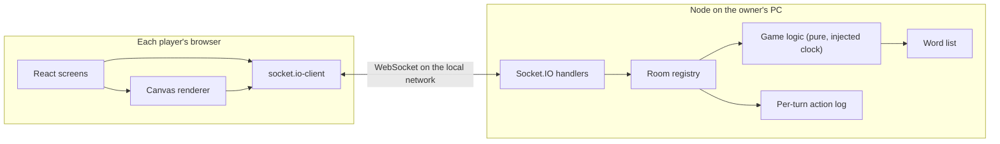

# Architecture: Screwdle R1

This document is how the pieces fit together. The decisions behind it are in the ADRs:

| ADR | Decision |
|---|---|
| [ADR-002](ADR-002.md) | The game runs on the owner's PC and is played over the local network |
| [ADR-003](ADR-003.md) | Drawing sync: the server keeps a per-turn action log |
| [ADR-004](ADR-004.md) | Rooms and game flow: an in-memory, server-authoritative state machine |
| [ADR-005](ADR-005.md) | Scoring: linear in time left; the drawer scores per correct guesser |
| [ADR-006](ADR-006.md) | Word list and guess matching |
| [ADR-007](ADR-007.md) | Game UI design |

## Overview

One Node process serves the built React client and the Socket.IO endpoint on port 3000 (ADR-002). Every browser keeps one Socket.IO connection. The server owns all game state; clients send intents and render what the server tells them.

## Workspaces

| Workspace | Holds | Notes |
|---|---|---|
| `shared` | Event names, payload types, constants (timers, palette, sizes, scoring), the word list, `normalizeGuess` | Imported by both sides, so the protocol has one definition |
| `server` | Socket.IO handlers (thin), room registry, game state machine, scoring, action log | Game logic has no I/O and takes a clock, so Vitest covers it with fake time |
| `client` | Screens (home, lobby, turn, results), canvas renderer, socket hook | The renderer replays action logs; the same code draws live and on sync |

## Event flow

Client → server events carry intents. The server checks them against the room's state and either applies them or ignores them.

| Event | Direction | Payload | Used by |
|---|---|---|---|
| `room:create` | C→S | `{ name, color }` | US-001 |
| `room:join` | C→S | `{ code, name, color, session? }` | US-002, US-018, US-019 |
| `room:state` | S→C | Full room view for this player (ADR-004) | lobby, turn, scores |
| `game:start` | C→S | `{}` (host only) | US-004 |
| `word:choose` | C→S | `{ index }` (drawer only) | US-010 |
| `chat:send` | C→S | `{ text }` | US-012 |
| `chat:message` | S→C | `{ from, text, kind }` | US-012, US-013 |
| `draw:begin` / `draw:points` / `draw:end` | both | ADR-003 | US-005, US-006, US-007 |
| `draw:fill` / `draw:undo` / `draw:clear` | both | ADR-003 | US-007, US-008, US-009 |
| `canvas:sync` | S→C | `{ actions }` | US-018, US-019 |
| `time:sync` | both | ping/pong for the clock offset | countdowns |

## Testing hooks

- Game logic and scoring are unit-tested in `server` with a fake clock (Vitest).
- `normalizeGuess`, word-list rules and the action-log replay are unit-tested in `shared` and `client`.
- Playwright tests open several browser contexts against one server, one per player (test plan).
- Stable `data-testid` attributes on the main screens are part of ADR-007.
